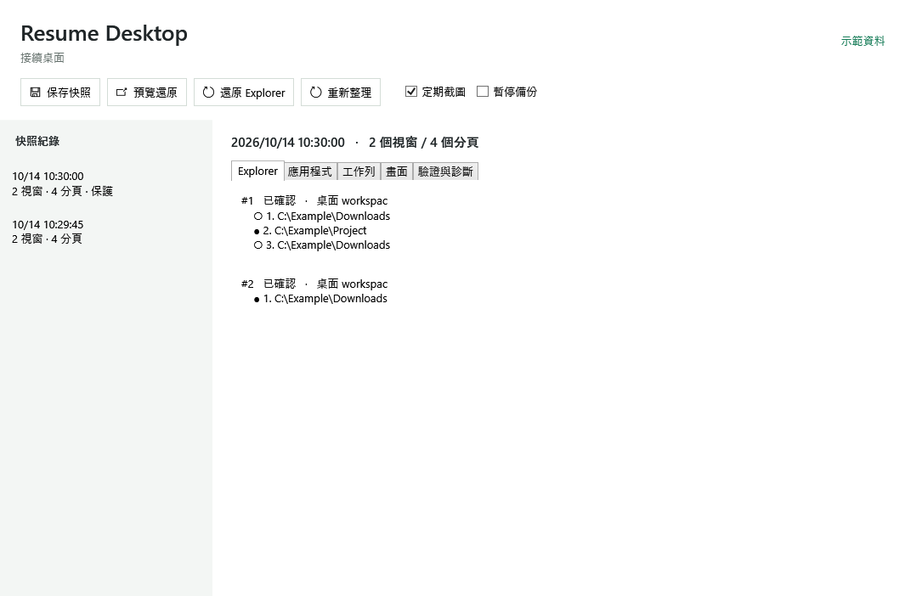

# Resume Desktop

[繁體中文](README.md) · [Status](docs/STATUS.md) · [Architecture](docs/ARCHITECTURE.md) · [Contributing](CONTRIBUTING.md)

Save Explorer windows, tabs and desktop reference images. Resume your workspace after an interruption.

## Status

**0.1.0 preview.** Explorer recovery is checked against the live shell. This does not restore arbitrary application memory, unsaved documents or browser sessions.

| Capability | State |
|---|---|
| Duplicate paths, window grouping, ordered tabs, active tab | Implemented; host verification is documented in the status page |
| Atomic snapshots, pre-loss checkpoints, DPAPI protection, retry ledger | Implemented |
| Placement, minimized/maximized state, Explorer stacking | Implemented; multi-monitor/DPI validation is limited |
| Local screenshots, application inventory, taskbar comparison | Implemented; some windows cannot provide images |
| Taskbar button order and virtual desktop assignment | Reference data only; rearrange manually |
| Explorer view mode, sorting and precise scroll offset | Not restored |
| Actual Explorer crash or Windows reboot | Destructive live testing not performed |

See [STATUS.md](docs/STATUS.md) for evidence and limitations. A successful build is not evidence of complete session restoration.



## Run

Download the Windows x64 ZIP from [Releases](https://github.com/29988122/resume-desktop/releases), extract it and run `ResumeDesktop.exe`. The runtime is included.

The UI currently defaults to Traditional Chinese. It records while running. Closing the main window hides it in the tray; choose the tray's exit command to stop. Select a snapshot, preview the changes and restore Explorer. Startup registration is optional and applies only to the current Windows user.

Duplicate windows and tabs are retained. Each existing window can satisfy only one source window. Extra live windows remain open. Unverified tab identities are reported instead of guessed. Background capture does not activate tabs. Restoration may move and activate Explorer windows.

The application never terminates or restarts Explorer, Start Menu hosts or other applications.

`Ctrl+Alt+F12` saves a protected snapshot when available; existing hotkey registrations are not overridden. Screenshot preferences persist across restarts.

```powershell
.\ResumeDesktop.exe probe
.\ResumeDesktop.exe capture --once
.\ResumeDesktop.exe status
.\ResumeDesktop.exe restore --snapshot <id> --explorer --preview
.\ResumeDesktop.exe restore --snapshot <id> --explorer --apply
```

`probe` is redacted by default. `--private-details` includes private paths. Preview and recovery diagnostics can also contain local paths; review them before sharing.

## Local data

Data stays under `%LOCALAPPDATA%\ResumeDesktop\`. Snapshot bodies and images are encrypted with current-user Windows DPAPI. Plain indexes contain counts, time and state only. No telemetry, cloud uploads or browser credential collection.

Structural polling is approximately five seconds, coalesced Explorer events 750 ms, thumbnail/taskbar capture 15 seconds and full-desktop capture 60 seconds. Bounded helpers isolate unresponsive COM and screenshot calls.

Ordinary history is retained for up to seven days with a 2 GiB ordinary image budget. Protected checkpoints are not automatically evicted and may exceed that budget. DPAPI data requires the original Windows user's keys; it is not a portable cross-machine backup.

## Build

Windows 11 x64 and .NET SDK 10.0.402. No third-party NuGet packages.

```powershell
dotnet build src/ResumeDesktop.App -c Release
dotnet run --project tests/ResumeDesktop.Tests -c Release
dotnet run --project src/ResumeDesktop.App -- probe
dotnet publish src/ResumeDesktop.App -c Release -r win-x64 --self-contained true -o artifacts/win-x64
```

Interactive smoke checks create and close only test-owned Explorer windows. They do not kill Explorer. See [CONTRIBUTING.md](CONTRIBUTING.md).

## License

[MIT](LICENSE). Contributions and reproducible reports are welcome. Community maintenance depends on actual contributors and is not guaranteed. See [third-party notices](THIRD_PARTY_NOTICES.md).
